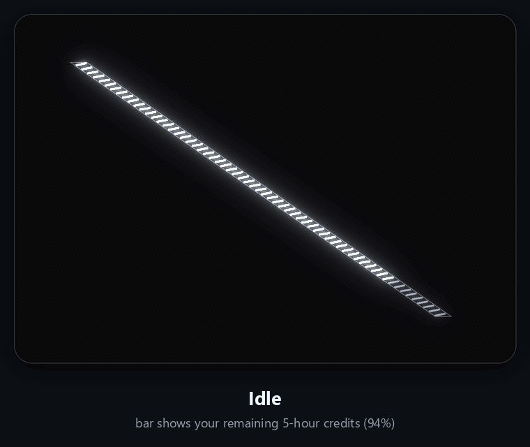
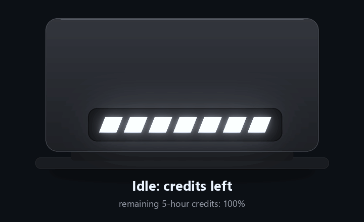
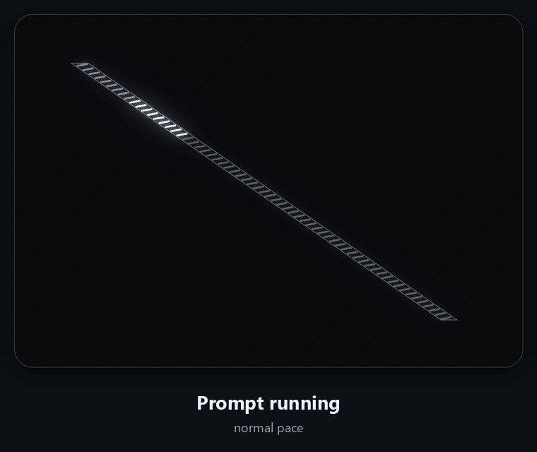
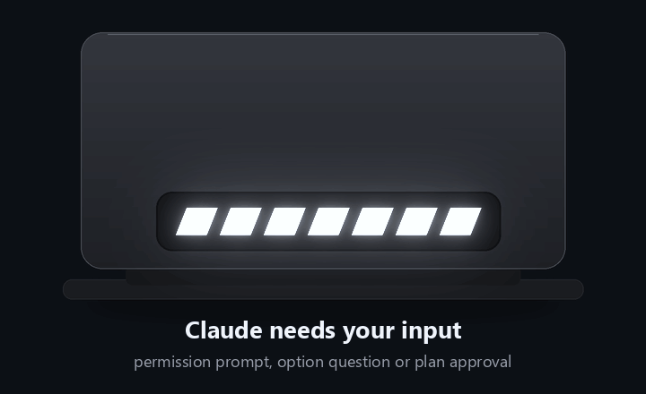

# rog-slashbar

Turn the **Slash** light bar on the back of an ASUS ROG Zephyrus G14 into a live dashboard for [Claude Code](https://claude.com/claude-code): see your remaining usage at a glance, know when a prompt is running, and get a blink when Claude is waiting on you.

<p align="center">
  
</p>

> The animations in this README are rendered from the project's own renderer (`rog-slashbar frames`) and drawn onto an illustration of the laptop lid. They show the logic, not footage of real hardware.
>
> The Slash is a diagonal strip of 63 small lights, running from the top-left to the bottom-right of the lid. They are grouped into **7 segments of 9**, and the hardware can only set a whole segment at a time, so every effect here works at segment level. The bar is anchored at the bottom-right end of the strip: as credits are used, the top-left end goes dark first.

## What the bar tells you

| Situation | Bar |
|---|---|
| **Idle**, or a prompt just finished | Your remaining 5-hour credits, anchored at the bottom-right end of the strip |
| **Prompt running** | One bright segment runs back and forth along the strip (the credits bar is hidden while it runs). It runs faster the faster you are using your limit |
| **Claude needs you** (permission prompt, option question, plan approval) | The whole bar blinks until you answer |

### Remaining credits

The default view. Full bar means plenty left; the last lit segment is dimmed to show partial amounts (each of the 7 steps is about 14% of your limit). Under 10% the first segment blinks.

<p align="center"></p>

### Prompt running

Triggered by your prompt and by every tool call. The runner's speed follows your burn rate (percent of the 5-hour limit used per minute over the last 10 minutes): about 1.8 s per pass when idle-ish, down to 0.4 s when burning fast.

<p align="center"></p>

### Claude needs your input

Detected from the `Notification` hook (permission prompts) and from `PreToolUse` for `AskUserQuestion` / `ExitPlanMode`. Claude's "still waiting for your input" nudge about a minute after it finishes is ignored, so the bar stays steady once a prompt is done.

<p align="center"></p>

Other views (weekly limit, context window) are one command away: `rog-slashbar ctl view 7d`, `ctx`, or `rotate` to cycle all three.

## Install

### As a Claude Code plugin (recommended)

```
/plugin install rog-slashbar --marketplace arxhr007/rog-slashbar
```

Or from your shell:

```
claude plugin install rog-slashbar --marketplace arxhr007/rog-slashbar
```

Then restart Claude Code and run `/rog-slashbar:setup` once. The plugin registers the hooks. `/rog-slashbar:setup` adds the status line, which a plugin cannot set itself; it asks before replacing a status line you already have.

Requirements: Windows, a Slash-equipped ROG laptop, and Claude Code on a claude.ai Pro/Max/Ultra plan (the status line only exposes usage limits for those).

#### What the plugin runs

- **`bin/rog-slashbar.exe`**, a small Windows program built from this repository's `src/` (about 450 KB). The hooks call it directly. It is the only program the plugin runs.
- On session start it copies itself to `~/.claude/slash/rog-slashbar.exe`, so the status line command keeps working when the plugin updates.
- It starts one background process (`rog-slashbar daemon`) that talks to the light bar over USB HID. That process exits after 20 minutes without updates or when the session ends.
- It reads and writes small JSON files in `~/.claude/slash/`.
- `/rog-slashbar:setup` edits the `statusLine` entry in `~/.claude/settings.json`, only when you run it, and asks before replacing an existing one.

It makes no network requests. See [Privacy](#privacy).

### Manual install (without the plugin)

**1. Build**

```
cargo build --release
```

Copy `target\release\rog-slashbar.exe` somewhere permanent, for example `C:\Tools\rog-slashbar\rog-slashbar.exe`.

**2. Close Armoury Crate and G-Helper.** They also write to the bar and will fight the daemon.

**3. Wire it into Claude Code.** Add this to `~/.claude/settings.json`, replacing the path. Use forward slashes: Claude Code runs commands through Git Bash, which strips backslashes.

```json
{
  "statusLine": {
    "type": "command",
    "command": "C:/Tools/rog-slashbar/rog-slashbar.exe status",
    "refreshInterval": 60
  },
  "hooks": {
    "SessionStart":     [{ "hooks": [{ "type": "command", "command": "C:/Tools/rog-slashbar/rog-slashbar.exe hook start",   "timeout": 5 }] }],
    "UserPromptSubmit": [{ "hooks": [{ "type": "command", "command": "C:/Tools/rog-slashbar/rog-slashbar.exe hook working", "timeout": 5 }] }],
    "PreToolUse":       [{ "hooks": [{ "type": "command", "command": "C:/Tools/rog-slashbar/rog-slashbar.exe hook working", "timeout": 5 }] }],
    "PostToolUse":      [{ "hooks": [{ "type": "command", "command": "C:/Tools/rog-slashbar/rog-slashbar.exe hook working", "timeout": 5 }] }],
    "Notification":     [{ "hooks": [{ "type": "command", "command": "C:/Tools/rog-slashbar/rog-slashbar.exe hook waiting", "timeout": 5 }] }],
    "Stop":             [{ "hooks": [{ "type": "command", "command": "C:/Tools/rog-slashbar/rog-slashbar.exe hook done",    "timeout": 5 }] }],
    "SessionEnd":       [{ "hooks": [{ "type": "command", "command": "C:/Tools/rog-slashbar/rog-slashbar.exe hook ended",   "timeout": 5 }] }]
  }
}
```

**4. Restart Claude Code** (hooks load at session start) and send a prompt. The daemon starts by itself; there is nothing to launch manually.

Check that it is alive:

```
rog-slashbar ctl status
```

## How it works

```
 Claude Code ──hooks──────────►  rog-slashbar hook <state>   ─┐
             ──status line────►  rog-slashbar status          ├─►  ~/.claude/slash/*.json
                                                              │          │
                                          rog-slashbar ctl ───┘          ▼
                                                                  rog-slashbar daemon ──HID──► Slash bar
                                                                  (renders at ~15 fps)
```

- `daemon` is the only process that talks to the bar. It is started automatically by any hook or status line call, takes a single-instance lock, and exits when the session ends or after 20 minutes without updates.
- `hook` and `status` only write small JSON files, so they start instantly and can never fight over the device.
- The renderer in `src/render.rs` is a pure function of (time, state files) and is covered by unit tests.

### State files (`~/.claude/slash/`)

| File | Written by | Contents |
|---|---|---|
| `agent.json` | hooks, `ctl set` | `{"state": "idle\|working\|waiting\|done\|ended", "ts": ...}` |
| `metrics.json` | status line | 5-hour / weekly / context remaining, burn rate, usage samples |
| `config.json` | `ctl view` | `{"view": "five_hour\|seven_day\|context\|rotate"}` |
| `heartbeat`, `daemon.lock`, `daemon.log` | daemon | liveness, single-instance lock, log |

## Commands

```
rog-slashbar daemon                       run the renderer (normally started automatically)
rog-slashbar hook <state>                 start | working | waiting | done | ended
rog-slashbar status                       status line command; reads session JSON on stdin
rog-slashbar ctl status                   show daemon, agent state, metrics, view
rog-slashbar ctl view rotate|5h|7d|ctx    cycle all views, or pin one (default: 5h)
rog-slashbar ctl set <state>              fake an agent state, handy for testing the bar
rog-slashbar ctl stop                     daemon exits and turns the bar off
rog-slashbar frames <state> <left> <burn> <seconds> [fps] [t0]
                                          dev tool: dump rendered frames as text
```

The status line also prints a summary into Claude Code, for example `5h:94% 7d:65% ctx:82% burn:0.3%/m`.

## Tunables

Constants in `src/`; changing one needs a rebuild.

| Setting | Value | Where |
|---|---|---|
| Segments | 7 (35 on long bars) | `render.rs` `N` |
| Frame rate | about 15 fps | `daemon.rs` |
| "Running" expires after | 180 s | `render.rs` |
| "Needs input" blink stops after | 90 s | `render.rs` |
| Burn-rate window | 10 min, at least 60 s of history | `status.rs` |
| Sweep period | 1.8 s at no burn, 0.4 s at a high rate | `render.rs` |
| Daemon idle exit | 20 min | `daemon.rs` |

## Troubleshooting

- **Bar stays dark.** Close Armoury Crate and G-Helper, then run `rog-slashbar ctl set idle` and check `~/.claude/slash/daemon.log` for `connected 0B05:...`.
- **Hooks never fire.** Check the paths use forward slashes, restart Claude Code, and run `/hooks` to confirm the entries are registered.
- **Status line shows `5h:n/a`.** Usage data only exists on Pro/Max/Ultra plans and only after the first API response of a session.
- **Rebuilding says access denied.** A running exe cannot be overwritten, but it can be renamed: rename `rog-slashbar.exe`, copy the new build in, then stop the old process.

## Verify the binary

`bin/rog-slashbar.exe` is committed to the repository and attached to each release. Its SHA-256 for this version (0.2.1) is:

```
0f65674069cce16ce4dc4ea6a36724e1cf440b19ed320518ef722a9c77ba9c56
```

Check it with `Get-FileHash bin\rog-slashbar.exe -Algorithm SHA256`. You can also build it yourself with `cargo build --release`; the result may not be byte-identical, because the release is built with `--remap-path-prefix` to keep local paths out of the binary.

## Privacy

- The program runs entirely on your machine and sends nothing anywhere. It makes **no network requests**.
- It reads the JSON Claude Code passes to hooks and the status line. It uses only the event name, the tool name, the notification type and message, and your usage numbers (5-hour and weekly limits, context window). It does not store prompts, tool inputs or file contents.
- State is kept in plain JSON files under `~/.claude/slash/`: the agent state, the latest usage numbers, a view setting, and a small log.

## Limitations

- Windows only, and only tested on a device that shows up as `0B05:19B6` (report ID `0x5D`, usage page `0xFF31`). `0B05:193B` is also tried.
- The bar protocol is unofficial and reverse-engineered. A firmware update could change it.
- Pressing Esc in Claude Code fires no hook, so "running" ends on its own after 3 minutes.
- Several simultaneous Claude sessions share one state; the last event wins.

## Development

```
cargo test                              unit tests (renderer and hook logic)
cargo build --release
pip install pillow
python docs/generate_gifs.py            regenerate the README animations and the plugin icon
```

`docs/generate_gifs.py` calls `rog-slashbar frames` for the real frame values and draws them with Pillow. Set `SLASH_CLAUDE_EXE` to use a different binary.

## Acknowledgments

The HID byte sequences follow [G-Helper](https://github.com/seerge/g-helper)'s `SlashDevice.cs` (GPL-3.0). This project is not affiliated with or endorsed by ASUS or Anthropic. "ROG" and "Republic of Gamers" are trademarks of ASUSTeK Computer Inc.

## License

GPL-3.0-only. See [LICENSE](LICENSE).

The HID commands this project sends were worked out with reference to [G-Helper](https://github.com/seerge/g-helper), which is also GPL-3.0.
